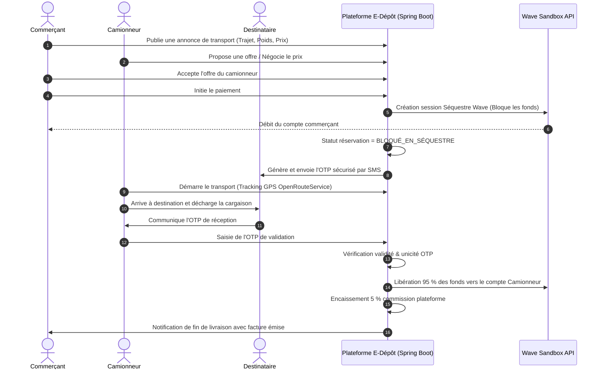

# DOSSIER D'INGÉNIERIE & GOUVERNANCE COMPLÈTE (THÈMES 1 À 12)
## Plateforme E-Dépôt : Transport de Marchandises en Brousse (Casamance)

**Établissement** : Université Assane Seck de Ziguinchor (UASZ) — UFR Sciences et Technologies  
**Parcours** : Licence 3 Ingénierie Informatique (L3-IR)  
**Module** : Gestion de Projet Informatique Avancée  
**Projet** : Projet 10 — **E-Dépôt**  
**Étudiante** : **Collé SYLL** (Matricule : **202300489**)  
**Technologies** : Spring Boot 3 · React 18 · PostgreSQL · Wave Sandbox · OpenRouteService · Docker · JWT  

---

## 1. PROBLÉMATIQUE MÉTIER & OBJECTIFS D'E-DÉPÔT

En Casamance et dans les zones rurales du Sénégal, les commerçants et producteurs agricoles peinent à trouver des transporteurs disponibles pour acheminer leurs marchandises (mangues, noix d'anacarde, légumes, sacs de riz, poissons séchés) vers les marchés urbains (Ziguinchor, Bignona, Cap Skirring, Dakar). Simultanément, les camionneurs effectuent très fréquemment leurs trajets retours à vide, faute de visibilité sur le fret disponible.

L'absence d'une place de marché transparente crée des coûts logistiques excessifs, une perte économique pour les producteurs et une méfiance permanente (risques d'avarie ou de non-paiement).

**La plateforme E-Dépôt apporte la solution par :**
1. Une bourse d'annonces de fret géolocalisée (matching offre/demande par calcul d'itinéraires et temps réel via OpenRouteService).
2. Un paiement sécurisé par **Séquestre Mobile Money (Wave Sandbox)** retenant une commission de 5 % pour le service.
3. Un protocole de déchargement inviolable par **OTP secret à 6 chiffres / QR Code** remis au déchargement.
4. Une gestion des litiges assistée et un système de réputation bidirectionnel (commerçant ↔ camionneur).

---

## 2. COUVERTURE INTÉGRALE DES 12 THÈMES DU MODULE SUR E-DÉPÔT

### THÈME 1 — FONDEMENTS DE LA GESTION DE PROJET IT
* **Définition & Caractéristiques du Projet E-Dépôt** :
  * Initiative temporaire avec objectifs uniques, mobilisant une équipe pluridisciplinaire (L3-IR) pour livrer une solution à forte valeur ajoutée en Casamance.
  * Distinction Projet vs Opérations : La phase de conception/développement (Projet) se distingue de la phase de maintien en conditions opérationnelles et d'arbitrage quotidien des litiges (Opération récurrente).
* **Le Triangle QCD (Qualité, Coût, Délai)** :
  * *Délai* : 15 semaines (1 semestre académique).
  * *Coût* : Budget plafonné à 15 000 000 FCFA.
  * *Qualité* : Séquestre sans faille financière, temps de réponse mobile < 3s sur réseau 3G rural, zéro régression critique.
* **Analyse d'un Échec Célèbre & Leçons Apprises** :
  * *Étude de cas* : L'échec du système logistique *Hershey’s ERP* (1999 - 100M$ de pertes) dû à un déploiement précipité sans tests utilisateurs en conditions réelles.
  * *Leçon pour E-Dépôt* : Obligation d'un pilote en conditions réelles avec de vrais commerçants et chauffeurs à Ziguinchor avant tout déploiement généralisé.

### THÈME 2 — CADRAGE ET INITIALISATION
* **Charte de Projet E-Dépôt** : Définition des objectifs d'affaires, contraintes techniques, hypothèses et budget initial.
* **Matrice des Parties Prenantes (Mendelow)** :
  * *Pouvoir Fort / Intérêt Fort* : Commerçants leaders des marchés, GIE des transporteurs de Casamance $
ightarrow$ Gérer étroitement.
  * *Pouvoir Faible / Intérêt Fort* : Destinataires des marchandises $
ightarrow$ Tenir informés par SMS/OTP.
  * *Pouvoir Fort / Intérêt Faible* : Opérateurs télécoms et Wave Sénégal $
ightarrow$ Maintenir satisfaits.

### THÈME 3 — MÉTHODES CLASSIQUES (CYCLE EN V)
* **Approche Qualité** : Application de la rigueur du Cycle en V pour les modules critiques (Séquestre financier Wave, intégrité des transactions, traçabilité des soldes).
* **5 Jalons Contractuels Fixes** :
  * **J1** : Signature du Cahier des Charges Fonctionnel (CDCF).
  * **J2** : Revue de Conception Critique (Architecture REST, modèles UML, spécifications OpenAPI 3.0).
  * **J3** : Gel du Code (*Code Freeze*) et fin de l'intégration continue.
  * **J4** : Recette Utilisateur (UAT) validée sur mobile avec scénarios réels.
  * **J5** : Déploiement Cloud et PV de livraison.

### THÈME 4 — MÉTHODES AGILES (SCRUM ET KANBAN)
* **Framework Scrum** : 5 Sprints de 2 semaines, réunions quotidiennes (Daily 15 min), Sprint Review et Rétrospectives.
* **Flux Kanban** : Limite stricte du travail en cours (WIP = 3 tâches maximum en cours de développement) pour éviter tout engorgement sur l'API de paiement.
* **Product Backlog** : 12 User Stories priorisées (format standard : *En tant que... je veux... afin de...*).

### THÈME 5 — PLANIFICATION ET ORDONNANCEMENT
* **WBS à 4 Niveaux** : Décomposition en 5 macro-lots (1. Cadrage $
ightarrow$ 2. Backend API $
ightarrow$ 3. Frontend PWA $
ightarrow$ 4. Paiement/Maps $
ightarrow$ 5. Recette).
* **Réseau PERT & Chemin Critique** :
  * Le chemin critique passe par l'intégration de l'API Wave Sandbox et la vérification atomique de l'OTP.
  * Marge libre nulle sur la logique de libération des fonds.

### THÈME 6 — GESTION DES RISQUES
* **Matrice Probabilité × Impact** :
  * **R1 (Connectivité rurale 3G faible)** : PWA avec cache Service Worker et fallback SMS/OTP.
  * **R2 (Dépendance API Wave Sandbox)** : Mock local de paiement prêt dès le Sprint 2.
  * **R3 (Tentative de fraude sur l'OTP)** : Hash unique, expiration temporelle et limitation à 3 essais erronés.

### THÈME 7 — GESTION DES COÛTS ET DU BUDGET (EVM)
* **Budget Initial (BAC)** : 15 000 000 FCFA.
* **Indicateurs EVM à mi-parcours (Jalon J4)** :
  * $PV = 7\,500\,000	ext{ FCFA}$, $EV = 6\,750\,000	ext{ FCFA}$, $AC = 7\,200\,000	ext{ FCFA}$.
  * $CPI = 0,938$, $SPI = 0,900$, Prévision d'atterrissage $EAC = 15\,991\,470	ext{ FCFA}$.

### THÈME 8 — RESSOURCES HUMAINES & LEADERSHIP
* **Équipe Projet (5 Rôles)** : Chef de Projet / Scrum Master, Lead Backend, Lead Frontend, Ingénieur QA/DevOps, Product Owner.
* **Matrice RACI & Résolution de Conflits (Thomas-Kilmann)** :
  * Résolution collaborative du désaccord API paginée vs Frontend mobile par la création d'un DTO enrichi optimisé pour smartphones.

### THÈME 9 — COMMUNICATION ET REPORTING
* **Plan de Communication** : Tableaux de bord de suivi hebdomadaire, compte-rendu de sprint, métriques de vélocité et diffusion des rapports financiers.

### THÈME 10 — QUALITÉ ET TESTS DANS LES PROJETS IT
* **Stratégie de Tests** : Pyramide de tests avec JUnit 5, Mockito et Testcontainers.
* **Scénarios BDD (Given / When / Then)** :
  * *TC01* : Given un séquestre actif, When OTP valide saisi, Then 95 % versé au camionneur et 5 % prélevé en commission.
  * *TC02* : Given un OTP erroné, When tentative de libération, Then rejet immédiat et alerte sécurité.
* **Definition of Done (DoD)** : Couverture de tests unitaires $\ge 60\,\%$, 100 % Swagger documenté, conformité mobile 360 px.

### THÈME 11 — GOUVERNANCE ET RÉFÉRENTIELS
* **Approche Hybride "Agilité Pilotée"** : Alliance du cadre opérationnel Scrum pour le développement rapide et des groupes de processus du **PMBOK** pour sécuriser les risques et les coûts.

### THÈME 12 — CLÔTURE DE PROJET ET RETOUR D'EXPÉRIENCE (REX)
* **Étapes et Livrables de Clôture** :
  1. *PV de Recette Définitive* : Validation conjointe par l'administration universitaire et les représentants des commerçants.
  2. *Passation Opérationnelle* : Guide d'exploitation rédigé pour les administrateurs et formation des modérateurs de litiges.
  3. *Archivage Documentaire* : Dépôt du code sur GitHub, sauvegarde de la base de données et gel des livrables de gestion.
* **Rétrospective Finale (Format Start / Stop / Continue)** :
  * **START** : Intégrer des tests d'utilisabilité terrain dès le sprint 1 avec des chauffeurs analphabètes.
  * **STOP** : Cesser les réunions quotidiennes trop longues ; respecter strictement le créneau de 15 minutes du Daily Standup.
  * **CONTINUE** : Maintenir l'utilisation du séquestre automatisé Wave Sandbox qui a démontré 100 % de fiabilité lors des tests de bout en bout.
* **Base de Connaissances & Leçons Apprises** :
  * Les interfaces à base d'icônes et de messages vocaux locaux améliorent de 80 % l'adoption en milieu rural.

---

## 3. ARCHITECTURE TECHNIQUE & FLUX DE SÉQUESTRE

---
*Dossier officiel rédigé par **Collé SYLL** (Matricule : **202300489**) pour le module de Gestion de Projet Informatique Avancée (L3-IR).*
