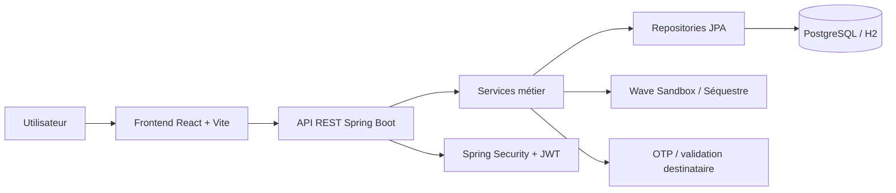
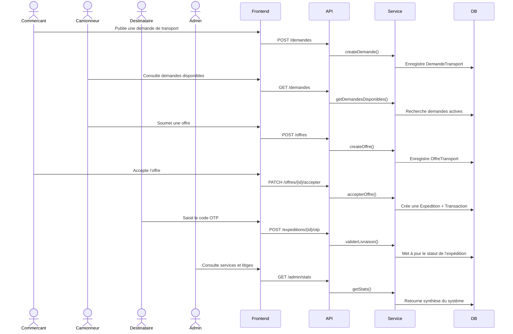

# Architecture technique – E-Dépôt

## 1. Objectif du système

E-Dépôt est une plateforme de logistique et de séquestre de fret pour les acteurs du transport en Casamance et dans les zones rurales du Sénégal. Elle permet :

- la publication de demandes de transport,
- la réception et la négociation des offres,
- la sécurisation du paiement via un mécanisme de séquestre,
- le suivi d’une expédition,
- la validation de livraison par OTP,
- la gestion des litiges et le suivi administratif.

Le système est conçu selon une architecture web moderne avec un frontend React, un backend Spring Boot et une base de données relationnelle.

## 2. Architecture globale



## 3. Composants du projet

### 3.1 Frontend

Technologies :
- React 18
- TypeScript
- Vite
- React Router
- Leaflet
- Lucide React

Rôle :
- afficher les interfaces utilisateur,
- gérer les parcours par rôle,
- appeler l’API backend,
- présenter les statuts de transport, les offres et les données financières.

### 3.2 Backend

Technologies :
- Java 17+
- Spring Boot 3
- Spring Web
- Spring Data JPA
- Spring Security
- Hibernate
- JWT
- OpenAPI / Swagger

Rôle :
- exposer l’API REST,
- organiser la logique métier,
- sécuriser les accès,
- gérer les transactions et les statuts d’expédition,
- imposer les règles de validation métier.

### 3.3 Base de données

Le projet est compatible PostgreSQL et dispose également d’une persistance locale en base H2 disque pour le développement et les tests.

Les données principales portent sur :
- les utilisateurs,
- les demandes,
- les offres,
- les expéditions,
- les transactions,
- les litiges,
- les évaluations.

## 4. Structure du dépôt

```text
E-DEPOT_PLATEFORME/
├── backend/
│   ├── src/main/java/sn/uasz/edepot/
│   │   ├── controller/
│   │   ├── dto/
│   │   ├── model/
│   │   ├── repository/
│   │   ├── security/
│   │   └── service/
│   ├── pom.xml
│   └── .env.example
├── frontend/
│   ├── src/
│   │   ├── api/
│   │   ├── auth/
│   │   ├── components/
│   │   ├── layouts/
│   │   ├── pages/
│   │   ├── styles/
│   │   └── types.ts
│   ├── package.json
│   └── vite.config.ts
├── docs/
│   ├── openapi.yaml
│   ├── DOSSIER_CONCEPTION_EDEPOT.md
│   └── DOSSIER_CONCEPTION_EDEPOT.pdf
├── README.md
├── demarrer_tout.bat
├── lancer_backend.bat
├── lancer_frontend.bat
├── arreter_tout.bat
└── package-lock.json
```

## 5. Séparation des rôles et accès

Le système distingue plusieurs profils :

- Commerçant / Agriculteur
- Camionneur / Transporteur
- Destinataire
- Administrateur

Chaque profil possède des vues et des responsabilités spécifiques :

- Commerçant : publie des demandes, négocie, valide les offres, sécurise le paiement.
- Camionneur : consulte les demandes, formule des offres, suit la livraison.
- Destinataire : reçoit la marchandise, valide par OTP, confirme la livraison.
- Administrateur : contrôle les comptes, litiges, volumes financiers et statistiques.

## 6. Flux fonctionnel principal



## 7. Modèle métier principal

### 7.1 Entités clés

- User
- DemandeTransport
- OffreTransport
- Expedition
- Transaction
- Litige
- Evaluation
- OperationFinanciere

### 7.2 Relations principales

- Un utilisateur peut publier plusieurs demandes.
- Une demande peut recevoir plusieurs offres.
- Une offre est liée à un camionneur et à une demande.
- Une demande acceptée devient une expédition.
- Une expédition génère des transactions et peut aboutir à un litige.

## 8. Sécurité et authenticité

La sécurité est assurée par plusieurs couches :

- Spring Security
- JWT pour l’authentification
- BCrypt pour le hachage des mots de passe
- validation des rôles et des permissions
- contrôle d’accès sur les API sensibles
- protection des points d’inscription et d’administration

Le rôle administrateur n’est pas proposé publiquement lors de l’inscription, ce qui renforce les garde-fous de sécurité.

## 9. Gestion du séquestre et du paiement

Le mécanisme de séquestre est central dans la plateforme :

- le commerçant sécurise une partie du montant conditionnellement,
- la plateforme perçoit une commission de 5 %,
- le camionneur est garanti sur la partie due,
- la libération des fonds est conditionnée à la validation de la livraison.

Ce mécanisme permet de sécuriser le paiement et de réduire les risques de litiges.

## 10. API REST

Le backend expose une API REST structurée par domaine métier :

- AuthController : connexion et inscription
- UserController : gestion des profils
- DemandeController : demandes de transport
- OffreController : gestion des offres
- ExpeditionController : suivi des expéditions
- TransactionController : gestion des transactions
- LitigeController : gestion des litiges
- EvaluationController : évaluation des services
- AdminStatsController : statistiques admins

La documentation OpenAPI est disponible dans le fichier `docs/openapi.yaml`.

## 11. Points d’extension

Le système est facilement extensible pour :

- l’ajout d’un paiement bancaire réel,
- l’intégration de notifications SMS/WhatsApp,
- la présence d’une cartographie plus avancée,
- l’intégration de tracking GPS,
- la gestion de plusieurs régions ou de nouveaux modes de transport.

## 12. Conclusion

L’architecture d’E-Dépôt est cohérente avec une plateforme de logistique numérique moderne : elle offre un découpage fonctionnel clair, une forte séparation des responsabilités, et un mécanisme de confiance entre commerçants, transporteurs et destinataires.

Cette base technique constitue un socle solide pour la maintenance, la montée en charge, les nouvelles fonctionnalités et la documentation du système.

## 13. Références in-repo

- `README.md`
- `docs/openapi.yaml`
- `docs/DOSSIER_CONCEPTION_EDEPOT.md`
- `docs/DOSSIER_CONCEPTION_EDEPOT.pdf`

