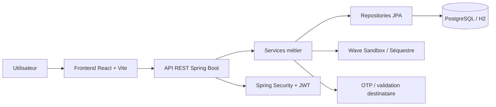
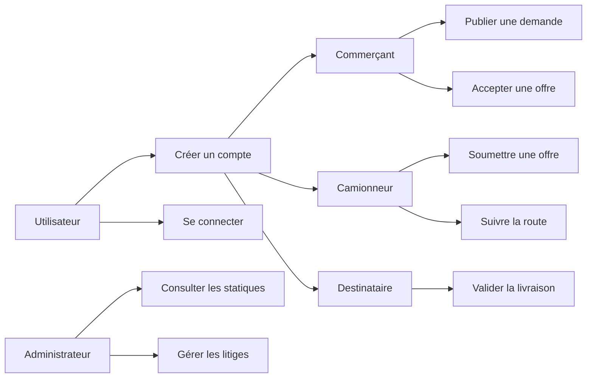
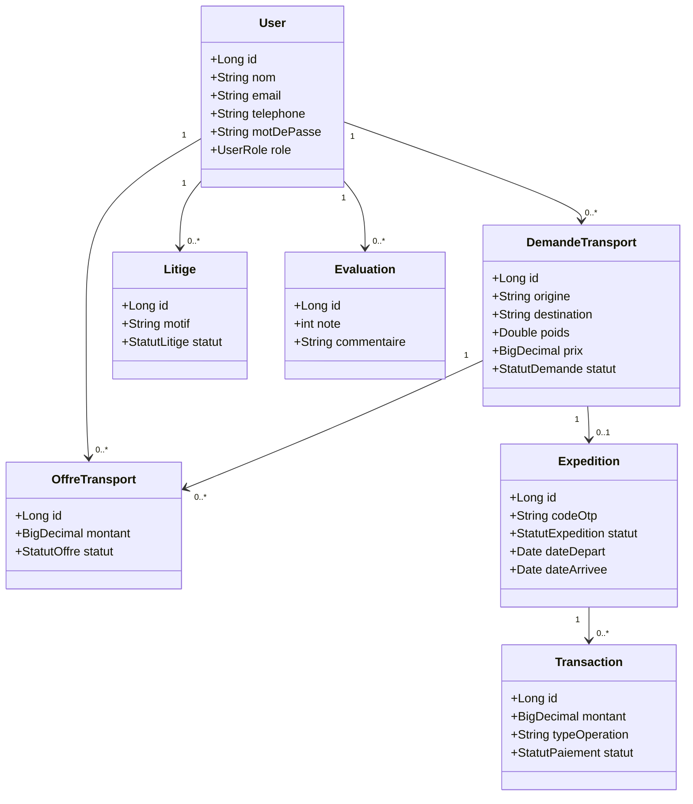
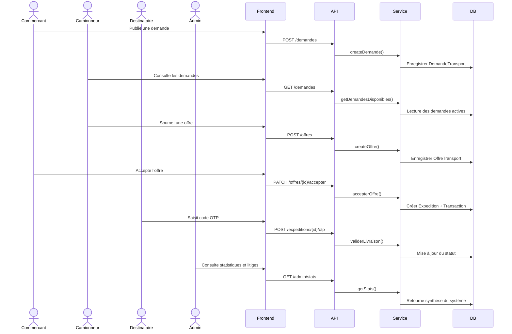
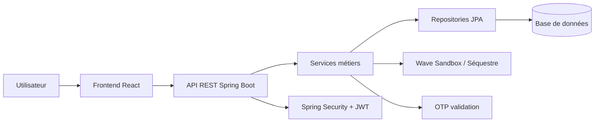

# Documentation technique et architecture – E-Dépôt

## 1. Contexte du projet

E-Dépôt est une plateforme de gestion logistique et de séquestre de fret conçue pour faciliter les transactions entre commerçants, transporteurs et destinataires dans les zones rurales du Sénégal, notamment en Casamance.

Le système vise à résoudre plusieurs problèmes récurrents :

- manque de visibilité sur les offres de transport disponibles,
- difficulté de sécurisation des paiements entre parties,
- faiblesse de la traçabilité des expéditions,
- manque de mécanismes de validation de livraison,
- difficultés de gestion des litiges et du suivi administratif.

L’application propose un modèle de transaction fiable dans lequel les fonds sont sécurisés avant déblocage, avec validation de livraison et suivi des étapes du transport.

## 2. Objectif général

Le système a pour objectif de :

- mettre en relation les acteurs du secteur logistique,
- sécuriser les transactions financières,
- assurer le suivi des expéditions,
- centraliser la gestion des litiges,
- fournir un tableau de bord administratif exploitable.

## 3. Architecture générale du système

Le projet repose sur une architecture client-serveur moderne, structurée en trois couches principales :

- Couche présentation : frontend React + Vite,
- Couche application : backend Spring Boot,
- Couche persistance : base de données relationnelle (PostgreSQL / H2).



## 4. Architecture logicielle

### 4.1 Frontend

Le frontend est développé avec React et TypeScript. Il permet :

- la gestion des écrans par profil utilisateur,
- la consultation des demandes disponibles,
- la soumission et la négociation des offres,
- la prise en charge du suivi d’expédition,
- la gestion des statuts et des tableaux de bord.

Technologies utilisées :

- React 18
- TypeScript
- Vite
- React Router
- Leaflet
- Lucide React

### 4.2 Backend

Le backend est basé sur Spring Boot 3. Il centralise la logique métier, la sécurité et l’accès aux données.

Technologies utilisées :

- Java 17+
- Spring Boot 3
- Spring Web
- Spring Data JPA
- Spring Security
- Hibernate
- JWT
- OpenAPI / Swagger

Le backend assure :

- la gestion de l’authentification,
- la protection des routes sécurisées,
- le contrôle des rôles,
- la validation des demandes et des offres,
- la gestion du séquestre financier,
- la logique de validation de la livraison,
- la gestion des litiges et du reporting administratif.

### 4.3 Base de données

Le système fonctionne avec une base de données relationnelle. En environnement de développement, il est compatible avec une base H2 locale, et en environnement de production, il peut être déployé sur PostgreSQL.

Les données concernent principalement :

- les utilisateurs,
- les demandes de transport,
- les offres de transport,
- les expéditions,
- les transactions financières,
- les litiges,
- les évaluations.

## 5. Diagramme de cas d’utilisation



## 6. Diagramme de classes métier



## 7. Diagramme de séquence principal



## 8. Diagramme de composants



## 9. Structure du dépôt

```text
E-DEPOT_PLATEFORME/
├── backend/
│   ├── src/main/java/sn/uasz/edepot/
│   │   ├── controller/
│   │   ├── dto/
│   │   ├── model/
│   │   ├── repository/
│   │   ├── security/
│   │   └���─ service/
│   ├── pom.xml
│   └── .env.example
├── frontend/
│   ├── src/
│   │   ├── api/
│   │   ├── auth/
│   │   ├── components/
│   │   ├── layouts/
│   │   ├── pages/
│   │   ├── styles/
│   │   └── types.ts
│   ├── package.json
│   └── vite.config.ts
├── docs/
│   ├── openapi.yaml
│   ├── DOSSIER_CONCEPTION_EDEPOT.md
│   └── DOSSIER_CONCEPTION_EDEPOT.pdf
├── README.md
├── demarrer_tout.bat
├── lancer_backend.bat
├── lancer_frontend.bat
├── arreter_tout.bat
└── package-lock.json
```

## 10. Rôles fonctionnels et accès

Le système distingue plusieurs types d’utilisateurs :

- Commerçant / Agriculteur : publie des demandes, négocie et valide les offres.
- Camionneur / Transporteur : soumet des offres et suit les expéditions.
- Destinataire : valide les livraisons par OTP.
- Administrateur : surveille les performances, les litiges et les transactions.

Cette séparation des rôles permet une meilleure sécurité, une meilleure traçabilité et un meilleur découpage fonctionnel.

## 11. Sécurité et authentification

Le projet intègre des mécanismes de sécurité rigoureux :

- Spring Security pour le contrôle d’accès,
- JWT pour l’authentification,
- BCrypt pour le hachage des mots de passe,
- filtrage des rôles selon le type d’utilisateur,
- protection des endpoints sensibles.

En particulier, le rôle administrateur est strictement réservé à l’administration système et n’est pas proposé publiquement pendant l’inscription.

## 12. Mécanisme de séquestre financier

Le cœur du système repose sur la sécurisation financière des transactions. Le mécanisme fonctionne comme suit :

- le commerçant publie une demande de transport,
- le camionneur propose une offre,
- la demande est acceptée après négociation,
- le montant est mis en sécurité dans un système de séquestre,
- la plateforme perçoit une commission de 5 %, 
- le reste est garanti pour le transporteur,
- la libération des fonds est conditionnée à la validation de la livraison par le destinataire via OTP.

Cette logique réduit les tensions entre partenaires, sécurise les transactions et limite les litiges.

## 13. API REST et intégration

Le backend expose une API REST structurée par module métier :

- AuthController : inscription et connexion
- UserController : gestion des profils et rôles
- DemandeController : publication et consultation des demandes
- OffreController : gestion des offres et négociations
- ExpeditionController : suivi de l’expédition et validation OTP
- TransactionController : gestion des paiements et séquestre
- LitigeController : traitement des litiges
- EvaluationController : notation des prestations
- AdminStatsController : supervision et statistiques

La documentation OpenAPI est disponible dans le fichier `docs/openapi.yaml`.

## 14. Points forts de l’architecture

- séparation claire entre frontend, backend et persistance,
- gestion explicite des rôles utilisateurs,
- logique métier centralisée dans les services Spring,
- sécurité forte basée sur JWT et BCrypt,
- mécanisme de séquestre adapté au contexte logistique,
- architecture évolutive pour intégrer de nouvelles fonctionnalités.

## 15. Limites et axes d’amélioration

Le système reste perfectible sur certains plans :

- intégration d’un vrai paiement bancaire ou mobile,
- notifications SMS/WhatsApp plus avancées,
- suivi GPS en temps réel,
- gestion plus fine des litiges et arbitrage multi-niveaux,
- amélioration des rapports et dashboards analytiques.

## 16. Conclusion

E-Dépôt est une plateforme logistique orientée sécurité, traçabilité et confiance entre acteurs. Son architecture actuelle répond bien aux exigences d’un système de gestion de transport avec séquestre, validation OTP et supervision administrative.

L’architecture en couches, l’usage de Spring Boot pour la logique métier et le choix d’une interface React pour la partie utilisateur permettent une bonne extensibilité et une maintenance simplifiée sur le long terme.

Cette documentation technique constitue une base solide pour la compréhension, la maintenance et le développement continu du projet.

## 17. Références internes au dépôt

- `README.md`
- `docs/openapi.yaml`
- `docs/DOSSIER_CONCEPTION_EDEPOT.md`
- `docs/DOSSIER_CONCEPTION_EDEPOT.pdf`
- `docs/architecture-technique.md`

